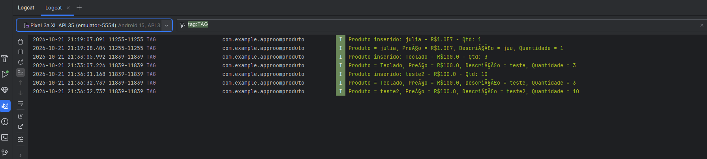
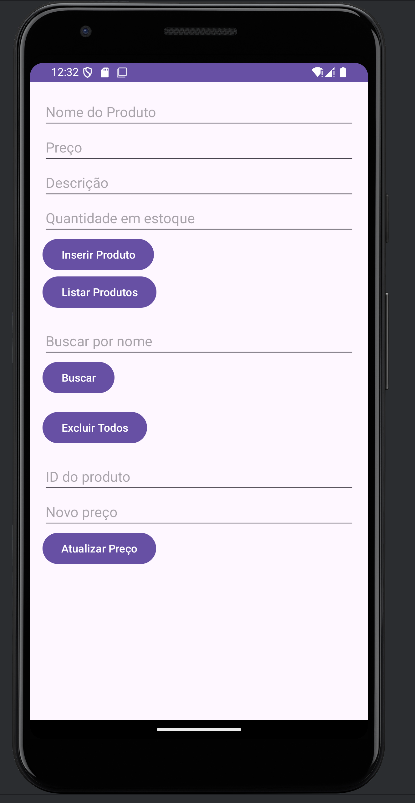

# AppRoomProduto: Cadastro de Produtos com Room SQLite

**Aluno(a):** Laryssa Flabio Ignacio
**RA:** 240274
**Disciplina:** Programação para Dispositivos Móveis
**Professor(a):** Alessandro

## Sobre o projeto
Aplicativo Android em Kotlin que cadastra e lista produtos
usando persistência local com Room (SQLite).

## Tecnologias
- Kotlin
- Room 2.6.1 (SQLite)
- ViewBinding
- Corrotinas (lifecycleScope)

## Prints do app



## Parte A: Complemento prático

### A1. Limpar campos após inserir
O que foi feito: depois que o produto é inserido com sucesso no banco, os campos são apagados com `text.clear()` e o cursor volta para o campo Nome com `requestFocus()`. O código fica dentro do `lifecycleScope.launch`, logo após o `insertAll`, para que os campos só sejam limpos quando o produto realmente foi salvo.

Trecho de código:
```kotlin
lifecycleScope.launch {
    productDao.insertAll(product)
    Toast.makeText(this@MainActivity, "Produto inserido!", Toast.LENGTH_SHORT).show()

    // A1: limpa os campos e volta o cursor para o Nome
    binding.editProductName.text.clear()
    binding.editProductPrice.text.clear()
    binding.editProductDescription.text.clear()
    binding.editProductQuantity.text.clear()
    binding.editProductName.requestFocus()
}
```

### A2. Validação de preço
O que foi feito: o preço digitado é convertido com `toDoubleOrNull()`. Se o resultado for nulo (campo vazio ou texto inválido) ou se o valor for zero ou negativo, o produto não é salvo e a mensagem "Informe um preço válido" aparece no próprio campo com `binding.editProductPrice.error`. O `return@setOnClickListener` interrompe o clique antes da inserção no banco.

Trecho de código:
```kotlin
// A2: não permite preço vazio, zero ou negativo
val price = priceText.toDoubleOrNull()
if (price == null || price <= 0) {
    binding.editProductPrice.error = "Informe um preço válido"
    return@setOnClickListener
}
```

### A3. Lista na tela
O que foi feito: foi adicionado um `TextView` (`txtListaProdutos`) abaixo dos botões, e a tela foi colocada dentro de um `ScrollView` para poder rolar. Ao clicar em Listar Produtos, o app busca os produtos com `productDao.getAll()` e a função `mostrarProdutos()` monta um texto com ID, nome, preço, descrição e quantidade de cada produto usando `joinToString`, exibindo no TextView. Se não houver produtos, aparece "Nenhum produto encontrado.".

Trecho de código:
```kotlin
binding.btnListarProdutos.setOnClickListener {
    lifecycleScope.launch {
        val products = productDao.getAll()
        mostrarProdutos(products)
    }
}

// dentro de mostrarProdutos():
binding.txtListaProdutos.text = products.joinToString("\n\n") {
    "ID ${it.id} - ${it.name}\n" +
        "Preço: R$ ${it.price}\n" +
        "Descrição: ${it.description}\n" +
        "Quantidade: ${it.quantity}"
}
```


### A4. Total do estoque
O que foi feito: foi adicionado um `TextView` (`txtTotal`) acima da lista. Na função `mostrarProdutos()`, a quantidade de produtos é calculada com `products.size` e a soma dos preços com `products.sumOf { it.price }`. O resultado aparece em negrito junto da lista, com a soma formatada com duas casas decimais.

Trecho de código:
```kotlin
// A4: quantidade de produtos e soma dos preços
val quantidade = products.size
val soma = products.sumOf { it.price }
binding.txtTotal.text =
    "Produtos cadastrados: $quantidade | Soma dos preços: R$ ${"%.2f".format(soma)}"
```

### A5. Buscar por nome
O que foi feito: foi criada no DAO a função `buscarPorNome` com a consulta `SELECT * FROM product WHERE name LIKE :nome`, além de um campo de busca (`editBusca`) e um botão Buscar no layout. O texto digitado é envolvido com `%` (`"%$texto%"`), fazendo o `LIKE` encontrar todos os produtos cujo nome contém aquele texto. Por exemplo, buscando "tec" aparecem os produtos "teclado".

Trecho de código:
```kotlin
// ProductDao.kt
@Query("SELECT * FROM product WHERE name LIKE :nome")
suspend fun buscarPorNome(nome: String): List<Product>

// MainActivity.kt
binding.btnBuscar.setOnClickListener {
    val texto = binding.editBusca.text.toString().trim()
    lifecycleScope.launch {
        val products = productDao.buscarPorNome("%$texto%")
        mostrarProdutos(products)
    }
}
```

### A6. Excluir produtos
O que foi feito: foi criada no DAO a função `deleteAll()` com a consulta `DELETE FROM product`, que apaga todos os registros da tabela, e um botão Excluir Todos no layout. Ao clicar, a exclusão roda dentro do `lifecycleScope.launch`, a lista da tela é limpa e aparece uma mensagem confirmando.

Trecho de código:
```kotlin
// ProductDao.kt
@Query("DELETE FROM product")
suspend fun deleteAll()

// MainActivity.kt
binding.btnExcluirTodos.setOnClickListener {
    lifecycleScope.launch {
        productDao.deleteAll()
        mostrarProdutos(emptyList())
        Toast.makeText(this@MainActivity, "Todos os produtos foram excluídos", Toast.LENGTH_SHORT).show()
    }
}
```

### A7. Atualizar produto
O que foi feito: foram criadas no DAO as funções `getById`, que busca um produto pelo id, e `update`, com `@Update`, que atualiza um produto existente. No layout foram adicionados os campos ID do produto e Novo preço e o botão Atualizar Preço. O app busca o produto pelo id, cria uma cópia com o novo preço usando `copy(price = novoPreco)` e salva com `update()`. O `@Update` encontra o registro certo pela chave primária (`id`). Se o id não existir, aparece "Produto não encontrado".

Trecho de código:
```kotlin
// ProductDao.kt
@Query("SELECT * FROM product WHERE id = :id")
suspend fun getById(id: Int): Product?

@Update
suspend fun update(product: Product)

// MainActivity.kt
lifecycleScope.launch {
    val produto = productDao.getById(id)
    if (produto == null) {
        Toast.makeText(this@MainActivity, "Produto não encontrado", Toast.LENGTH_SHORT).show()
    } else {
        productDao.update(produto.copy(price = novoPreco))
        Toast.makeText(this@MainActivity, "Preço atualizado!", Toast.LENGTH_SHORT).show()
        mostrarProdutos(productDao.getAll())
    }
}
```

### A8. Novo campo na tabela
O que foi feito: foi adicionado o atributo `quantity: Int` (quantidade em estoque) na entidade `Product`, com `@ColumnInfo(name = "quantity")` e valor padrão `0`, e um campo "Quantidade em estoque" no layout. A quantidade é salva no cadastro e exibida na lista. Como a estrutura da tabela mudou, a versão do banco em `@Database` foi alterada de 1 para 2.

O que aconteceu com os produtos já cadastrados: eles foram apagados. Ao abrir o app com a versão 2, o Room percebeu que o banco salvo no celular ainda estava na versão 1, com a tabela sem a coluna `quantity`. Para atualizar sem perder dados seria necessária uma *Migration* (por exemplo, `ALTER TABLE product ADD COLUMN quantity INTEGER NOT NULL DEFAULT 0`). Como o projeto não tem nenhuma Migration e usa `fallbackToDestructiveMigration()`, o Room apagou o banco antigo e criou um novo do zero, já com a coluna nova. Por isso a lista ficou vazia depois da mudança.

Trecho de código:
```kotlin
// Product.kt
@Entity
data class Product(
    @PrimaryKey(autoGenerate = true) val id: Int = 0,
    @ColumnInfo(name = "name") val name: String,
    @ColumnInfo(name = "price") val price: Double,
    @ColumnInfo(name = "description") val description: String?,
    @ColumnInfo(name = "quantity") val quantity: Int = 0
)

// AppDatabase.kt
@Database(entities = [Product::class], version = 2)
abstract class AppDatabase : RoomDatabase() {
    abstract fun productDao(): ProductDao
}
```

## Parte B: Questões dissertativas

### B1. O que é persistência de dados?
Resposta: Persistência de dados é a capacidade de um aplicativo guardar informações de forma que elas continuem existindo mesmo depois que o app é fechado ou o celular é reiniciado. No meu projeto, os produtos são salvos em um banco SQLite dentro do celular usando o Room, e por isso continuam lá quando abro o app de novo e clico em Listar. Se eu guardasse os produtos apenas em uma `MutableList` dentro da `MainActivity`, eles ficariam só na memória RAM. Ao fechar o app, ou até ao girar a tela (quando a Activity é recriada), a lista seria perdida e todos os produtos sumiriam. Ou seja, a lista em memória serve para dados temporários, e o banco de dados para dados que precisam durar.

### B2. Qual é a diferença entre usar o SQLite diretamente e usar o Room?
Resposta: Usando o SQLite diretamente com `SQLiteOpenHelper`, é preciso escrever todos os comandos SQL na mão, criar a tabela manualmente e converter cada linha do resultado (o `Cursor`) em objeto, campo por campo, o que gera muito código repetitivo e fácil de errar. O Room é uma camada em cima do SQLite que faz esse trabalho. A primeira vantagem é que ele verifica as consultas SQL na compilação: se eu escrever uma coluna errada no `@Query`, o projeto nem compila, em vez de o app fechar depois. A segunda vantagem é que ele converte os resultados automaticamente em objetos Kotlin, como a `List<Product>` do `getAll()`. Ele também tem suporte a corrotinas com `suspend`, facilitando o acesso fora da thread principal.

### B3. Explique o papel de Entity, DAO e Database.
Resposta: A **Entity** é a classe que representa uma tabela do banco. No meu projeto é a `Product`, marcada com `@Entity`, em que cada atributo (`id`, `name`, `price`, `description` e `quantity`) vira uma coluna. O **DAO** é a interface com os comandos de acesso ao banco: no `ProductDao` ficam `getAll()`, `insertAll()`, `buscarPorNome()`, `deleteAll()` e `update()`, cada uma com sua anotação (`@Query`, `@Insert`, `@Update`). O **Database** é a classe que junta tudo e cria o arquivo do banco: o `AppDatabase`, com `@Database(entities = [Product::class], version = 2)`, liga a entidade ao DAO pela função `productDao()`. Na `MainActivity`, crio o banco com `Room.databaseBuilder`, pego o DAO com `db.productDao()` e uso suas funções.

### B4. Por que o Android não permite acessar o banco na thread principal? O que é um ANR?
Resposta: A thread principal (UI thread) é responsável por desenhar a tela e responder aos toques do usuário. Acessar o banco pode demorar, e se isso fosse feito nela, a tela ficaria travada até a operação terminar. Se o app ficar travado por alguns segundos, o Android mostra o **ANR** (Application Not Responding), a mensagem perguntando se o usuário quer esperar ou fechar o app. Por isso o Room bloqueia esse acesso e o app fecha com o erro "Cannot access database on the main thread". No meu projeto, as funções do DAO são `suspend`, o que permite que elas pausem sem travar a thread, e são chamadas dentro do `lifecycleScope.launch`, que abre uma corrotina ligada ao ciclo de vida da Activity. Assim o banco é acessado sem travar a tela, e a corrotina é cancelada sozinha se a Activity for fechada.

### B5. O que faz o fallbackToDestructiveMigration()? Por que é perigoso em um app publicado?
Resposta: O `fallbackToDestructiveMigration()` diz ao Room que, quando a versão do banco mudar e não existir uma migração definida, ele pode apagar o banco inteiro e criar um novo do zero. Foi o que aconteceu no item A8: ao adicionar o campo `quantity` e mudar a versão de 1 para 2, todos os produtos sumiram. Durante o desenvolvimento isso é prático, mas em um app publicado na Play Store seria um problema sério, porque ao receber uma atualização o usuário perderia todos os dados salvos. Uma **Migration** é um código que ensina o Room a transformar o banco de uma versão para outra sem perder dados. Por exemplo, a migração da versão 1 para a 2 executaria `ALTER TABLE product ADD COLUMN quantity INTEGER NOT NULL DEFAULT 0`, adicionando a coluna e mantendo os produtos existentes.

### B6. Qual é a vantagem do ViewBinding em relação ao findViewById?
Resposta: Com o `findViewById`, é preciso buscar cada componente manualmente pelo id e informar o tipo dele. Se o id estiver errado ou não existir naquele layout, o erro só aparece com o app rodando, normalmente como um `NullPointerException` que fecha o app. O ViewBinding gera automaticamente uma classe para cada layout (no meu caso a `ActivityMainBinding`), com uma propriedade para cada componente com id, como `binding.editProductName` e `binding.btnInserirProduto`. Como isso é verificado na compilação, um id inexistente já fica vermelho no Android Studio. Isso aconteceu comigo no A8: o `editProductQuantity` ficou vermelho até eu adicionar o campo no layout. Ele também já conhece o tipo certo de cada componente, evitando erros de conversão (cast).

### B7. Por que em apps maiores é recomendado criar o banco como Singleton?
Resposta: Criar uma instância do banco é uma operação pesada, que consome memória e processamento. No tutorial o banco é criado na `MainActivity`, o que funciona porque o app tem uma tela só. Em um app maior, se cada tela criasse o seu próprio banco com `Room.databaseBuilder`, haveria várias conexões abertas para o mesmo arquivo ao mesmo tempo. Isso gasta memória à toa, deixa o app mais lento e pode causar conflitos, com uma tela não enxergando na hora o que outra salvou. O padrão **Singleton** garante uma única instância do banco para o app inteiro, criada uma vez e reaproveitada por todas as telas. Normalmente isso é feito com um `companion object` no `AppDatabase`, com uma função que devolve a instância existente ou cria uma nova se ainda não houver.

### B8. Reflexão pessoal: dificuldades e um app real
Resposta: Uma das principais dificuldades foi que o pacote do meu projeto ficou `com.example.approomproduto`, diferente do `br.universidade.approomproduto` do tutorial, então precisei ajustar o pacote nos códigos. Também tive problemas ao colar o layout: em uma das vezes o arquivo ficou cortado pela metade e apareceram erros, que resolvi conferindo se as tags `</LinearLayout>` e `</ScrollView>` estavam no final. No A8, o `editProductQuantity` ficou vermelho na `MainActivity` porque eu ainda não tinha criado o campo no layout. Depois de adicioná-lo e usar **Build > Rebuild Project**, o erro sumiu. Um app real em que a persistência com Room seria útil é um controle de estoque para uma pequena loja: o dono poderia cadastrar produtos, preços e quantidades mesmo sem internet, e os dados ficariam salvos no celular. Eu aplicaria a mesma estrutura deste projeto, com a entidade `Product`, um DAO com cadastro, busca, atualização e exclusão, e o banco criado como Singleton.

## Como executar
1. Clone o repositório
2. Abra no Android Studio
3. Execute em um emulador (API 24+)